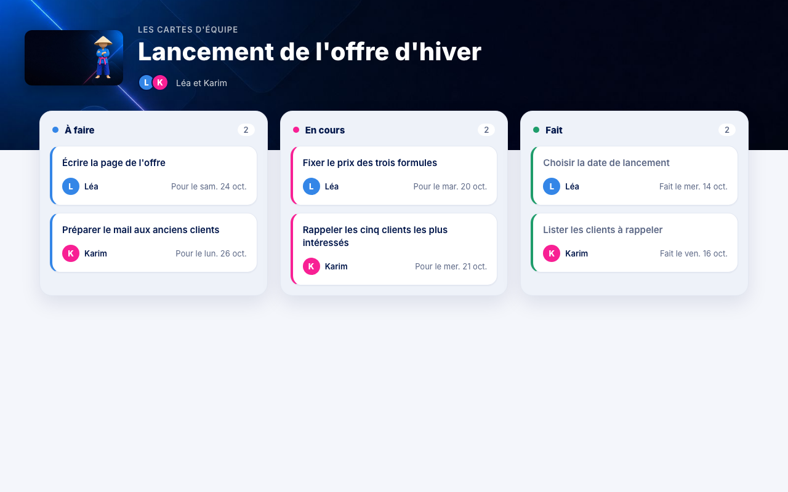

# KreaTask

Le kit de départ du live KreaCity « Ta première app métier en 3 étapes très
simples » : un tableau de cartes, à la Trello, que tu construis avec Claude
Code sur PocketBase.

Tout est dans le dossier : PocketBase (la base de données et le serveur), les
données d'un projet de démonstration et un premier écran. Tu lances, le tableau
s'affiche. La suite se construit avec Claude Code, partie par partie.



## Ce qu'il te faut

- Un abonnement Claude et **Claude Code** installé.
- Un Mac (puce Apple ou Intel) ou un PC Windows.

Rien d'autre à installer : PocketBase est déjà dans le dossier.

## 1. Récupérer le dossier

Sur la page GitHub du kit : bouton vert **Code**, puis **Download ZIP**.
Ouvre le ZIP : tu obtiens un dossier `KreaTask-main`.

1. Renomme ce dossier `KreaTask`.
2. Déplace-le dans ton dossier personnel (sur Mac, celui qui porte ton nom,
   avec une petite maison dans le Finder).

**Jamais sous Bureau ni Documents** : la synchronisation iCloud ou OneDrive y
abîme les fichiers de la base.

Tu connais Git ? `git clone https://github.com/KreaCity/KreaTask.git`
dans ton dossier personnel fait la même chose.

## 2. Lancer le tableau

**Sur Mac.** Ouvre le Terminal, va dans le dossier, lance `demarrer` :

```bash
cd ~/KreaTask
./demarrer
```

**Sur Windows.** Double-clique sur `demarrer.bat`.

Le navigateur s'ouvre sur `http://127.0.0.1:8090` : le tableau du projet de
démonstration s'affiche, en trois colonnes. Au tout premier lancement, un
deuxième onglet s'ouvre aussi : la création de ton compte d'administration
(étape 3). Pour arrêter : `Ctrl + C` dans le
terminal. Pour relancer : la même commande.

Tu peux aussi demander à Claude Code de le lancer pour toi : « lance le
tableau avec ./demarrer, en arrière-plan ».

### Si ton ordinateur bloque le lancement

Un fichier téléchargé sur internet est marqué par le système, qui peut refuser
de le lancer la première fois.

- **Mac** : `demarrer` retire lui-même cette marque sur le dossier. Si macOS
  affiche quand même « impossible de vérifier le développeur », ouvre
  **Réglages Système**, puis **Confidentialité et sécurité**, descends jusqu'au
  message qui parle de `pocketbase` et clique **Ouvrir quand même**. Ou, dans
  le Terminal, depuis le dossier : `xattr -dr com.apple.quarantine .`
- **Windows** : si un écran bleu « Windows a protégé votre ordinateur »
  apparaît, clique **Informations complémentaires**, puis **Exécuter quand
  même**.

## 3. Créer ton compte d'administration

Au premier lancement, le terminal affiche un lien qui se termine par
`pbinstall/…` (et PocketBase l'ouvre souvent tout seul). Ouvre-le et crée ton
compte : e-mail et mot de passe, ceux que tu veux, ils restent sur ton
ordinateur.

Tu arrives dans le tableau d'administration de PocketBase
(`http://127.0.0.1:8090/_/`). Tu y vois les trois collections :

- `users` : les personnes de l'équipe ;
- `projets` : les projets, avec leurs membres ;
- `cartes` : les cartes, avec leur titre, leur responsable, leur échéance,
  leur statut et leur place dans la colonne.

Lien perdu ? Arrête le serveur, puis dans le dossier :
`./pocketbase superuser upsert ton@email.fr ton-mot-de-passe`
(sur Windows : `.\pocketbase.exe superuser upsert …`).

## Les comptes de démonstration

Deux personnes fictives, pour tester en local seulement :

| Prénom | E-mail | Mot de passe |
|---|---|---|
| Léa | `lea@exemple.test` | `demo-cartes-2026` |
| Karim | `karim@exemple.test` | `demo-cartes-2026` |

## Repartir de zéro

Arrête le serveur et supprime le dossier `pb_data`. Au prochain lancement, la
base est recréée avec le projet de démonstration. Ton compte d'administration
part avec elle : tu le recrées par le lien du terminal, comme à l'étape 3.

## La suite : construire avec Claude Code

Ouvre Claude Code dans le dossier (`claude`) et laisse-toi guider : le fichier
`CLAUDE.md` lui dit ce qui est déjà fait et ce qui vient ensuite. Le besoin
complet est dans `PRD.md`.

1. **Les données** : déjà posées.
2. **Les fonctions** : créer une carte, la déplacer, la date de fin
   automatique.
3. **L'interface** : le glisser-déposer, à la souris comme au doigt, et les
   cartes qui bougent chez tout le monde en direct.

## Ce qu'il y a dans le dossier

- `demarrer`, `demarrer.bat` : le lancement, sur Mac et sur Windows.
- `archives/` : PocketBase 0.40.5 tel que publié par ses auteurs.
- `pb_migrations/` : la structure des données et le projet de démonstration.
- `pb_public/` : l'écran, en HTML et JavaScript simples.
- `pb_hooks/` : le code qui tourne côté serveur (vide pour l'instant).
- `demo/` : les images du projet de démonstration.
- `verifier.sh` : vérifie, sur Mac, que le kit démarre sur un dossier neuf.
- `pb_data/` : ta base, créée au premier lancement. Elle reste chez toi.

Licences : voir `LICENCES.md`.
